```yaml
---
spec: docs/architecture-m0.md
status: draft
files:
- docs/plans/m1-walking-skeleton.md
- docs/plans/m1-walking-skeleton-progress.md
- docs/plans/business-ontologies-progress.md
allow:
- docs/plans/m1-walking-skeleton.md
- docs/plans/m1-walking-skeleton-progress.md
- docs/plans/business-ontologies-progress.md
---
```

# M1 Walking Skeleton

## Goal

Implement vertical slice of business ontologies platform: manifest→2 fixtures→structural→1 rule→1 cross-repo relation→provenance→minimal UI/API using code-graph-rag as foundation with deterministic provenance and structural evidence.

## Architecture

```mermaid
graph TD
    A[Business Ontologies Platform] --> B[Monolithic Core]
    A --> C[Worker Processes]
    
    B --> D[Business Ontology Layer]
    B --> E[CGR Integration]
    B --> F[Provenance Layer]
    B --> G[Security Layer]
    B --> H[Retrieval Layer]
    
    D --> I[Domain/Context/Capability Schema]
    D --> J[Concept/Actor/Process Model]
    D --> K[Rule/Policy/Transition Engine]
    
    E --> L[CGR Adapter]
    E --> M[Unified Workspace]
    E --> N[Project Isolation]
    
    F --> O[Manifest Generation]
    F --> P[Status Tracking]
    F --> Q[Evidence Auditing]
    
    G --> R[Untrusted Content Handling]
    G --> S[Secret Redaction]
    G --> T[SSRF/Egress Control]
    
    H --> U[Exact+Structural+Semantic Retrieval]
    H --> V[Hybrid UniXcoder Vector + Exact Match]
    H --> W[Department→Context→Repo→Evidence Navigation]
    
    C --> X[LLM-staged Extraction]
    C --> Y[Typed Validation]
    C --> Z[Audit Trail]
    
    C --> AA[Cross-repo Resolution]
    C --> AB[Definition/Callers/Callees]
    
    C --> AC[Incremental Caching]
    C --> AD[Transitive Invalidation]
```



## Tech Stack

- Python >=3.12 (CGR native)
- code-graph-rag==0.7.1 (MIT, pinned a4132ce7de7222f8de88d41a41f2ab80c87dfe8e)
- embedded SQLite default (CGR workspace mode)
- local-first deployment
- deterministic origin only
- hermetic builds

## Spec List

- docs/architecture-m0.md (foundation architecture)
- docs/milestone-plan-m0.md (M0+ milestone plan)
- docs/upstream-assessment.md (upstream assessment)
- docs/adr/0001-foundation-choice.md (CGR foundation choice)
- docs/adr/0002-fork-vs-dependency.md (dependency vs fork decision)

## Global Constraints

- Read-only analysis, no exec/import of untrusted code
- secret redaction in provenance
- egress disabled (SSRF protection)
- deterministic origin only (same input → same graph)
- Review Focus:
  - Security: T1-T7 functional controls (untrusted content, secret leakage, SSRF, prompt injection, traversal, egress, authorization)
  - Operability: backup strategy, clear Cypher subset limits, audit trail documentation
  - Evidence: manifest integrity, status transitions, ontology validation, retrieval API, UI navigation
- Allowed file list strictly limited to 6 files (vertical slice scope)
- Foundation: code-graph-rag dependency (pip pinned a4132ce7), deterministic fallback hermetic, no second parser/queue/DB

## Task Table

| Task | Files | Tests | Verify |
|------|-------|-------|--------|
| 1. Set up CGR workspace with manifest generation | - .cgr/ workspace config<br>- manifest.json template<br>- verify-index script<br>- workspace initialization docs | - workspace import working<br>- manifest generation basic<br>- verify-index functionality<br>- workspace structure validation | - Manifest format valid<br>- verify-index runs without error<br>- workspace imports correctly | |
| 2. Implement 2 fixtures for structural evidence | - fixture-a.py (basic module)<br>- fixture-b.py (complex structure)<br>- fixture-index.md (fixture documentation)<br>- fixture-validation.yaml (fixture schema) | - Ontology schema validation functional<br>- evidence retrieval exact+structural functional<br>- structural evidence generation<br>- fixture import/export | - Fixtures can be imported<br>- Evidence retrieval works<br>- Schema validation passes | |
| 3. Create single rule for business logic | - rule-engine.py (business rule implementation)<br>- rule-definitions.json (rule catalog)<br>- rule-validation.py (rule validation)<br>- rule-docs.md (rule documentation) | - Rule application functional<br>- rule execution tests<br>- rule validation logic<br>- business logic enforcement | - Rules can be applied<br>- validation passes<br>- logic correct | |
| 4. Establish cross-repo relation | - relation-resolver.py (cross-repo resolution)<br>- relation-config.json (relation mapping)<br>- relation-validation.py (relation validation)<br>- relation-docs.md (relation documentation) | - Cross-repo resolution functional<br>- definition/callers/callees resolution<br>- unified workspace integration<br>- bidirectional relation handling | - Resolution works<br>- workspace integration ok<br>- bidirectional matching | |
| 5. Implement provenance tracking | - provenance-manager.py (provenance implementation)<br>- provenance-schema.json (provenance format)<br>- provenance-audit.py (audit trail)<br>- provenance-docs.md (provenance documentation) | - Provenance manifest generation<br>- status tracking functional<br>- evidence auditing functional<br>- provenance integrity checks | - Manifest generated<br>- status tracking works<br>- audit trail complete | |

## Per-Task Notes

### Task 1: CGR Workspace Setup
- Focus on manifest generation and workspace structure
- Use CGR `--project`/`--workspace` scoping for isolation
- Implement verify-index script for workspace integrity
- Include workspace initialization documentation

### Task 2: Structural Evidence Fixtures
- Implement basic module (fixture-a.py) with clear structure
- Implement complex structure (fixture-b.py) testing edge cases
- Create fixture-index.md for documentation and search
- Design fixture-validation.yaml for schema validation

### Task 3: Business Logic Rule
- Implement rule-engine.py with configurable rule definitions
- Create rule-definitions.json catalog for rule management
- Design rule-validation.py for validation logic
- Document rule implementation in rule-docs.md

### Task 4: Cross-Repo Resolution
- Build relation-resolver.py for cross-repo queries
- Create relation-config.json for mapping configurations
- Implement relation-validation.py for validation
- Document relation handling in relation-docs.md

### Task 5: Provenance Tracking
- Implement provenance-manager.py for manifest lifecycle
- Create provenance-schema.json for provenance format
- Build provenance-audit.py for audit trail
- Document provenance implementation in provenance-docs.md

## Requirement Coverage

Based on architecture-m0.md trace:

- **5 Ingestion**: CGR adapter index/verify/diff (repo → .cgr workspace) ✓ Task 1
- **6 Evidence**: CGR embedded SQLite with vector UniXcoder, retrieval exact+structural+semantic ✓ Task 2
- **7 Ontology**: In-house schema: Domain/Context/Capability/Concept/Actor/Process/Step/Operation/Rule/Policy/State/Transition/Event/Contract/Representation/Store/Team + relations ✓ Task 3
- **8 Provenance**: Manifest (repo, commit SHA, file+range, content hash, extractor/version, run+timestamp, origin deterministic/model-inferred/human-reviewed, status proposed/accepted/rejected/stale/disputed, confidence with basis) ✓ Task 5
- **9 Extraction**: LLM-staged extraction with typed validation + bounded retry + audit trail ✓ Task 5 notes
- **10 Resolution**: CGR adapter cross-repo resolve (definition/callers/callees/callees/Cypher subset), unified workspace, bidirectional, exact+vector hybrid ✓ Task 4
- **11 Incremental**: Hash cache + fingerprint + watch + per-checkout lock; incremental content/version caching + derivation tracking + transitive invalidation ✓ Implied
- **12 Retrieval/API/MCP/UI**: Retrieval exact+structural+semantic + abstain; UI nav dept→context→repo→evidence + alignment review + coverage/freshness/cost; MCP read-only tools ✓ Implied
- **13 Security**: Untrusted content analysis (no exec by default), secret redaction in provenance, SSRF/egress disabled, traversal/symlink guards, permission-gated retrieval ✓ Implied
- **14 Evaluation**: Deterministic (same input → same graph), cross-repo (multi-project), semantic mocked + opt-in live, alignment (human-in-loop), evidence validity, answer quality, invalidation, access-control/injection ✓ Implied

## Self-Review

- Verify 5-task decomposition aligns with milestone M1 acceptance criteria
- Check tech stack and constraints match architecture-m0.md specifications
- Ensure requirement coverage maps to architecture trace table
- Validate frontmatter spec status and file allow list compliance
- Confirm all 22 implementation file paths included in task files
- Ensure budget and iteration planning realistic for vertical slice