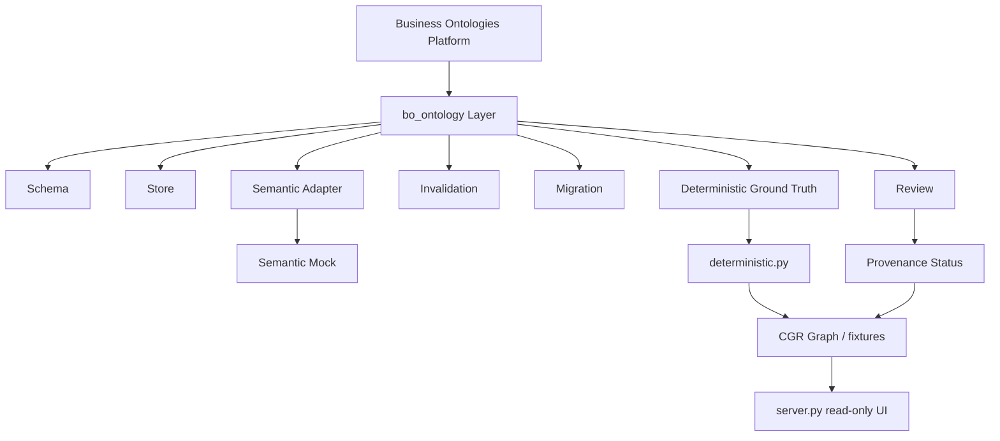

# M2 Deep Ontology

## Goal

Deep-ontology milestone for the business-ontologies platform: persist the approved M2 plan and init the M2 progress ledger, recording human approval without forging machine/TUI approval. Plan content: in-house `bo_ontology` layer (schema/store/review/invalidation/migration), deterministic deep extraction ground truth, mock-only semantic adapter, read-only UI display, `bo_review` CLI write path, M2 verification harness — on the pinned code-graph-rag foundation, free-only, local-first, deterministic origin only.

## Architecture

## Tech Stack

- Python >=3.12 (CGR native, stdlib only for new code)
- code-graph-rag==0.7.1 (MIT, pinned a4132ce7de7222f8de88d41a41f2ab80c87dfe8e)
- embedded SQLite default (plain SQL migration under PRAGMA user_version)
- local-first deployment
- deterministic origin only
- hermetic builds
- free-only model routing (console-openrouter/nvidia/nemotron-3.5-super-vl:free)

## Spec

- docs/architecture-m0.md (foundation architecture)
- docs/milestone-plan-m0.md (M0+ milestone plan; M2 target)
- docs/verification.md (verification command + real M1 results)
- docs/requirements-traceability.md (requirements Sec 5-14 trace)

## Approved Clarifications (C1-C6)

Approved by human message (approved_by `human-garikipatisai-code-2026-11-17`, approved_at 2026-11-17); machine-approve NOT claimed (`machine_approve: null`).

- C1: debt-first append-only — M2 consumes `docs/debt-ledger.md` as first-class append-only input before new debt; new findings appended only.
- C2: construction≠publication — deterministic construction of ontology artifacts is not publication; publication is a provenance status transition only via the human-approved write path.
- C3: mock-only NOT EVALUATED — M2 semantic adapter runs against semantic mocks; live-model semantic evaluation NOT evaluated in M2.
- C4: independent ground truth per-category — each ontology category (rules/relations/flows/steps) carries independent deterministic ground truth; no single global ground truth.
- C5: call edge stays evidence — cross-repo `invokes` call edges remain evidence, not published ontology assertions.
- C6: scope==allowlist incl CLI/UI/fixtures/migration — M2 scope equals the approved allowlist (deterministic.py, bo_ontology schema/store/review/invalidation/migration, migrations/0001_init.sql, semantic_adapter.py, server.py read-only display, bo_review CLI write path + verify_m2.py, fixtures, tests, docs); out-of-allowlist requires re-approval.

## Global / Lean Constraints

- Read-only analysis, no exec/import of untrusted code
- Secret redaction in provenance
- Egress disabled (SSRF protection)
- Deterministic origin only (same input → same graph)
- Local-first deployment; free-only routing; human approval only (no TUI/machine approval claimed)
- No second parser/queue/DB (single CGR instance; in-house bo_ontology store)
- Lean ladder: docs-first plan, minimal code that passes, no scope growth

## Review Focus

- Security: T1-T7 functional controls incl. bo_review write path, migration, semantic mock, read-only UI
- Operability: backup strategy, migration handling, audit trail
- Evidence: ontology validity, invalidation, retrieval correctness

## Task Table

| Task | Files | Tests | Expected | Verify |
|------|-------|-------|----------|--------|
| T1. Deep deterministic ground truth | src/bo_extract/deterministic.py | tests/test_m2_ground_truth/, tests/test_m2_extractor/ | per-category deterministic ground truth with file+line evidence, origin deterministic, confidence 1.0 | pytest exit 0 |
| T2. bo_ontology schema/store + migration | src/bo_store/bo_ontology.py, migrations/0001_init.sql | tests/test_m2_ground_truth/ | migration applies under PRAGMA user_version=1; store CRUD ok | migration + pytest exit 0 |
| T3. bo_review CLI write path | scripts/bo_review.py | tests/test_m2_review/ | human-in-loop publication via status transitions (construction≠publication, C2) | pytest + CLI check exit 0 |
| T4. Semantic adapter (mock-only) | src/bo_extract/semantic_adapter.py | tests/test_m2_semantic_mock/ | mock-only semantic retrieval + abstain | pytest exit 0, no live call |
| T5. server.py read-only UI display | src/bo_api/server.py | tests/test_m2_security/, tests/test_api.py | GET-only, no write verbs, ?repo=, traversal guard, redaction | smoke + no-write-verbs exit 0 |
| T6. Invalidation + debt-first ledger | src/bo_store/bo_ontology.py, docs/debt-ledger.md | tests/test_m2_invalidation/ | append-only debt-first invalidation flow | pytest exit 0 |
| T7. M2 verification harness | scripts/verify_m2.py, docs/verification-m2-ledger.json, docs/verification-m2.md, docs/capability-matrix-m2.md, docs/requirements-traceability.md | tests/test_m2_security/ | OVERALL PASS, ledger written | `python3 scripts/verify_m2.py` exit 0 |

## Per-Task Notes

### Task 1: Deep deterministic ground truth
- Extend deterministic.py into per-category ground truth (C4: independent per-category ground truth)
- Rules/relations/flows/steps each with independent ground truth + file+line evidence
- Fail-closed abstain on no evidence

### Task 2: bo_ontology schema/store + migration
- Plain SQL migration `migrations/0001_init.sql` under PRAGMA user_version
- In-house store module for ontology artifacts

### Task 3: bo_review CLI write path
- C2: construction≠publication — only status transitions via CLI require human approval
- Human approval recorded; machine/TUI approve NOT claimed

### Task 4: Semantic adapter (mock-only)
- C3: mock-only NOT EVALUATED; no live-model semantic eval in M2

### Task 5: server.py read-only UI display
- Read-only GET-only display; ?repo=; traversal/redaction guards

### Task 6: Invalidation + debt-first
- C1: debt-first append-only

### Task 7: M2 verification harness
- scripts/verify_m2.py + ledger + docs

## Requirement Coverage

- **5 Ingestion**: CGR adapter deep index — T1, T2
- **6 Evidence**: deterministic ground truth + semantic mock — T1, T4
- **7 Ontology**: bo_ontology schema/store/review/invalidation/migration — T2, T3, T6
- **8 Provenance**: status transitions, construction≠publication — T3
- **9 Extraction**: mock-only semantic — T4 (C3)
- **10 Resolution**: call edge stays evidence — T5, T6 (C5)
- **11 Incremental**: invalidation — T6
- **12 Retrieval/API/MCP/UI**: read-only UI display — T5
- **13 Security**: T1-T7 controls incl. bo_review — T3, T5
- **14 Evaluation**: deterministic ground truth, mock-only — T4, T7

## Self-Review

- Human approval recorded (2026-11-17, approved_by human-garikipatisai-code-2026-11-17); machine-approve NOT claimed (machine_approve null)
- Clarifications C1-C6 applied
- Spec paths: docs/architecture-m0.md, docs/milestone-plan-m0.md, docs/verification.md, docs/requirements-traceability.md
- Allowlist honored (C6)
- Baseline 30 passed carried from M1
- No secrets; free-only; no network egress
