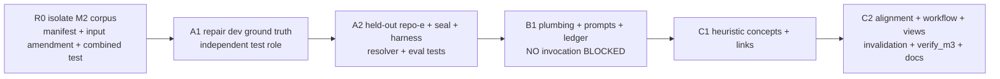

# Goal

Consolidated recovery-and-M3 execution: isolate original M2 input corpus (R0), complete M3A evidence/contract/eval on dev + sealed held-out, add M3B provider-neutral plumbing only (BLOCKED execution), and deliver M3C alignment/workflow/read-only views/invalidation — without weakening assertions or expanding scope.

# Architecture

- Components touched: `src/bo_extract` (heuristic + semantic adapter stub), `src/bo_resolve` (contract resolver, compatibility\u2240equivalence), `src/bo_eval` (sealed harness, thresholds), `src/bo_ontology/alignment.py` (typed mappings incl. `insufficient-evidence` + `distinctFrom`), `src/bo_api/views_m3.py` mounted in `server.py` (read-only).
- Interfaces consumed: `fixtures/m2-corpus.json` (original repo-a/b/c list), `fixtures/repo-d/*` (dev), `fixtures/repo-e/*` (held-out, sealed), `docs/m3_heldout_seal.json`, `prompts/m3b/*` (stored prompts only).
- Interfaces produced: eval reports with denominators + raw counts + false positives, artifact ledger entries, alignment workflow with unresolved segment, `scripts/verify_m3.py` gate, `docs/verification-m3.md` + `docs/m3-capability.md` + traceability append.

# Tech Stack

- Python-only, no new external deps. Java/Spring gate preserved post-M3 (untouched). No NVIDIA integration.
- Tests: `python -m pytest <files> -v`. Gate: `python scripts/verify_m3.py`. No commit/push.

# Spec

- Approved: `docs/plans/m3-gated-ontology.md` (restored, SHA `acfc449396e3165c3a3bed8ea536342b84693e6456ec8e674d190a43ec735249`), `docs/architecture-m0.md`, `docs/verification-m2.md`, precedent `tests/test_m2_ground_truth.py`.

# Global Constraints

- Python-only; no new external deps; Java/Spring gate preserved; no NVIDIA integration; no commit/push.
- Eval rules frozen BEFORE runs: denominators + matching/scoring defined first; thresholds concept/rule \u226575%, relation \u226570% + 0 false equiv, citation 100% format / \u226590% support, abstention 100%; report raw counts + false positives; recall never presented as overall correctness.
- Held-out discipline: inputs available only during designated eval, answers only to evaluator; tuning on held-out reclassifies it as dev.
- No commit/push from plan execution.

# Lean Constraints

- Rung: reuse-first. Reuse M2 extraction/indexing, M2 verification pattern, existing `repo-d` fixtures; add only manifest (`fixtures/m2-corpus.json`), resolver, harness, adapter stub, alignment, mount-only views.
- Manifest-vs-helper: chose `fixtures/m2-corpus.json` (ONE, data-only) over new tests helper \u2014 JSON list of repo-a/b/c is auditable, needs only `json.load` inline, avoids executable helper that could mask inputs.
- No abstraction: no new framework, no provider SDK, no ORM; file-local functions; prompts are stored markdown, not code.

# Review Focus

- R0 exception narrowness: only input-selection lines in `tests/test_m2_extractor.py` change; assertions + fixture bytes untouched; unauthorized-diff + recovery history preserved.
- No production name-lists: `extract()` takes explicit paths, no fixture-name special-casing.
- No weakened/vacuous tests: every repaired/stub test asserts behavior; no empty verification.
- M3B has zero invocation/egress/download/paid/fallback; BLOCKED labels present; execution waits on separate future auth (provider/endpoint/egress/caps/artifacts/decision).
- Contract resolver tests prove compatibility\u2240equivalence; invalidation test proves stale + history preserved; combined-index test proves BOTH state machines retained; transition-count expectations unchanged.

| # | Task | Spec req | Files | Test | Expected | Verify |
|---|------|----------|-------|------|----------|--------|
| R0 | Incident isolation: original M2 corpus manifest + frozen-test input amendment + combined-index retention test | INC-1 isolate corpus, preserve assertions; M2 gate | `fixtures/m2-corpus.json`, `tests/test_m2_extractor.py`, `tests/test_m2_combined_index.py` | New combined-index test asserts both state machines indexed; amended extractor test selects only manifest-listed corpus | `fixtures/m2-corpus.json` lists original repo-a/b/c; `test_m2_extractor` passes on original corpus; combined test green; full M1/M2 rerun green | `python -m pytest tests/test_m2_extractor.py tests/test_m2_combined_index.py tests/test_m2_ground_truth.py -v` |
| A1 | Repair M3 dev ground truth via independent test role | M3A-DEV (evidence fixtures repo-d review fixes; dev ground-truth repair) | `fixtures/repo-d/*`, `tests/test_m3_dev_ground_truth.py` | Repaired dev ground-truth test fills empty event stubs, adds missing client/server + shared-table assertions, fixes vacuous fetch, keeps no-src-imports independence | Dev ground-truth test fails before fix on stubs/vacuous fetch, passes after with behavioral assertions | `python -m pytest tests/test_m3_dev_ground_truth.py -v` |
| A2 | Held-out repo-e + seal + harness + thresholds + resolver + eval/contract tests (frozen before eval) | M3A-EVAL (held-out seal/harness/thresholds; compatibility\u2240equivalence; eval tests) | `fixtures/repo-e/*`, `docs/m3_heldout_seal.json`, `src/bo_resolve/*`, `src/bo_eval/*`, `tests/test_m3_heldout_sealed.py`, `tests/test_m3_contract.py`, `tests/test_m3_eval.py` | Contract test proves compatibility\u2240equivalence; sealed held-out test enforces seal + evaluator-only answers; eval test checks denominators + thresholds + raw counts/FP | repo-e contains required 5 shapes; seal frozen pre-eval; thresholds enforced as specified | `python -m pytest tests/test_m3_contract.py tests/test_m3_eval.py tests/test_m3_heldout_sealed.py -v` |
| B1 | M3B plumbing + stored prompts + protocol tests, mocked, BLOCKED | M3B-PLUMB (provider-neutral plumbing, validation, budget caps, ledger, stored prompts; NO invocation) | `src/bo_extract/semantic_adapter.py`, `prompts/m3b/concept-extraction.md`, `prompts/m3b/relation-extraction.md`, `prompts/m3b/citation-grounding.md`, `prompts/m3b/abstention-policy.md`, `tests/test_m3b_protocol.py` | Mocked protocol test proves validation + caps + ledger + prompt loading with zero egress; semantic demo paths labeled BLOCKED | Plumbing loads stored prompts, validates, caps, ledgers without network/paid/fallback | `python -m pytest tests/test_m3b_protocol.py -v` |
| C1 | Heuristic concepts + links (evidence extraction, no semantics) | M3A-EXT (heuristic evidence extraction) | `src/bo_extract/heuristic_concepts.py`, `tests/test_m3_dev_ground_truth.py` | Dev ground-truth heuristic assertions pass on repo-d concepts/links | Heuristic extraction yields concepts + links without semantic calls | `python -m pytest tests/test_m3_dev_ground_truth.py -v` |
| C2 | Alignment + workflow + read-only views + invalidation + verify_m3 + docs | M3C-ALIGN (typed mappings + unresolved segment; mount-only views; review integration; contract-change invalidation) | `src/bo_ontology/alignment.py`, `src/bo_api/views_m3.py`, `src/bo_api/server.py`, `tests/test_m3_alignment.py`, `scripts/verify_m3.py`, `docs/m3-capability.md`, `docs/verification-m3.md`, `docs/traceability.md` | Alignment test asserts `insufficient-evidence` + `distinctFrom` + unresolved segment; invalidation test asserts stale flag + history preserved; `verify_m3.py` gates all | Views mount-only read-only; semantic demo labeled BLOCKED; docs record capability/traceability | `python -m pytest tests/test_m3_alignment.py -v && python scripts/verify_m3.py` |

## Requirement coverage

- [ ] every AC maps to \u21d2 1 task; every task names a spec req; no orphan task; no task edits its own grader (sole exception: R0 input-selection-only amendment, pre-authorized deliberate reviewed documented exception)
- [ ] Approval boundaries: M3A + M3B-plumbing + M3C-infra execution; M3B execution separate; no commit/push; deps none new

## Test integrity

New tests are deliverables verified by scripts; sealed files frozen in A2. If a grader is wrong, stop and escalate \u2014 do not weaken tests.

## Self-review

Authoritative consolidated draft restored from session history (planner output ses_e15508c7affe). Frontmatter: 27 file paths + allow 2 ledger files, verbatim. Status draft, approved_by/at empty — execution NOT approved by this persist.
---END PLAN---