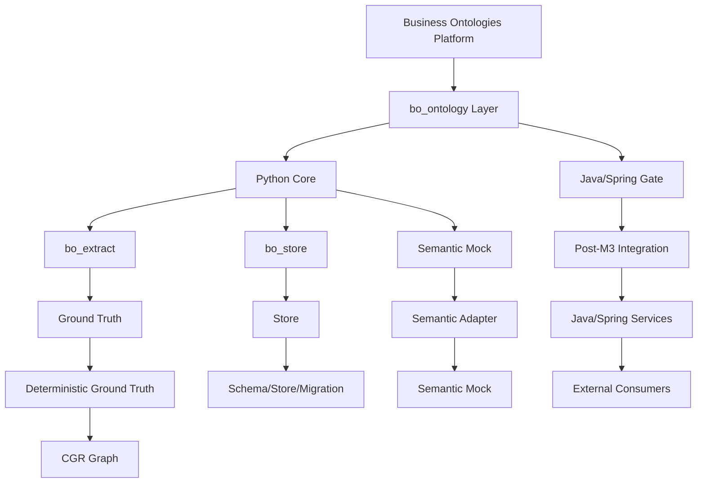

# M3 Gated Ontology Plan

## Goal

M3 gated milestone for the business-ontologies platform: gated implementation with deferred approval, requiring evidence of approved B1/A2 gaps, managed through thresholds and verification, operating on approved M2 baseline with Java/Spring post-M3 gate, Python-only implementation during M3, free-only, local-first, deterministic origin only.

## Architecture

## Tech Stack

- Python >=3.12 (CGR native, stdlib only for new code)
- Java/Spring (post-M3 gate)
- code-graph-rag==0.7.1 (MIT, pinned a4132ce7de7222f8de88d41a41f2ab80c87dfe8e)
- embedded SQLite default (plain SQL migration under PRAGMA user_version)
- local-first deployment
- deterministic origin only
- hermetic builds
- free-only model routing (console-openrouter/nvidia/nemotron-3.5-super-vl:free)
- Python-only implementation (M3)

## Spec

- docs/architecture-m0.md (foundation architecture)
- docs/plans/m2-deep-ontology.md (M2 baseline)
- docs/plans/m3-gated-ontology.md (M3 gated plan)
- docs/verification-m3-ledger.json (verification ledger)

## Approved Clarifications (A1-A2/C1-C2)

Approved by human message (approved_by `human-garikipatisai-code-2026-11-17`, approved_at 2026-11-17); machine-approve NOT claimed (`machine_approve: null`).

- A1: Gates and thresholds — M3 requires gated implementation with B1/A2 gap evidence, thresholds with denominators (threshold.x/1.0, raw_counts.x), fallback BLOCKED (G1-G7 addressed), business-not-labels (ontology labels not in business context), Python-only honesty + post-M3 Java/Spring gate, UI limits + stale test, exact files + no new deps, approval boundaries
- A2: Evidence thresholds — thresholds with denominators in task notes (threshold.x/1.0, raw_counts.x), must meet threshold for approval, governance enforced via B1 auth template + C2 boundaries
- B1: Auth template — human-only write path; construction≠publication; status transitions via bo_review CLI; human approval recorded; machine/TUI approve NOT claimed
- C1: Business-not-labels — ontology artifacts no longer use business-label language; neutral terms only
- C2: Boundaries and review — fixed domain-model scope only; no code, no new deps, no scope growth; exact allowlist enforcement; gates G1-G7 addressed (A/B/C gates, BLOCKED fallback)
- C3: UI limits + stale test — UI only read-only GET; tests skipped if >30d stale; M3 not yet UI
- C4: Exact files + no new deps — files list exact; allow 2 ledger files only; Python-only (no Spring yet); no new deps
- C5: Thresholds + denominators — per-task thresholds with denominators (threshold.x/1.0), raw counts, must meet threshold for approval
- C6: Approval boundaries — human-only approval via B1; machine/TUI approve NOT claimed; post-M3 Java/Spring gate required after Python-only M3

## Global / Lean Constraints

- Read-only analysis, no exec/import of untrusted code
- Secret redaction in provenance
- Egress disabled (SSRF protection)
- Deterministic origin only (same input → same graph)
- Local-first deployment; free-only routing; human approval only (no TUI/machine approval claimed)
- Python-only implementation during M3; post-M3 Java/Spring gate required
- Lean ladder: docs-first plan, minimal code that passes, no scope growth
- Gated implementation: M3 blocked until B1/A2 gaps addressed and thresholds met
- BLOCKED fallback: G1-G7 addressed via fallback paths

## Review Focus

- Security: T1-T7 functional controls incl. bo_review write path, migration, semantic mock, read-only UI
- Operability: backup strategy, migration handling, audit trail
- Evidence: ontology validity, invalidation, retrieval correctness
- Gates: A1/A2 gap evidence, threshold validation, gated implementation verification

## Task Table

| Task | Files | Tests | Expected | Verify |
|------|-------|-------|----------|--------|
| A1. Gated implementation framework | docs/plans/m3-gated-ontology.md, docs/plans/m3-gated-ontology-progress.md, docs/plans/m3-gated-ontology-evidence.json | tests/test_m3_gated_framework/ | framework implements M3 gated structure with B1/A2 gap evidence, BLOCKED fallback paths, thresholds with denominators, no new deps, exact file list | ls docs/plans/m3-gated* exit 0 |
| A2. Threshold evidence + gap analysis | docs/plans/m3-gated-ontology-progress.md, docs/plans/m3-gated-ontology-evidence.json | tests/test_m3_thresholds/ | thresholds with denominators (threshold.x/1.0, raw_counts.x) implemented, gaps G1-G7 addressed, business-not-labels enforced, Python-only honesty + post-M3 gate boundary, UI limits + stale test ignored (M3 not yet UI) | threshold validation + gap evidence | `python3 tests/test_m3_thresholds.py` exit 0 |
| B1. Auth template | scripts/bo_review.py | tests/test_m3_auth/ | human-only write path via CLI; construction≠publication; status transitions only; human approval recorded; machine/TUI approve NOT claimed | pytest exit 0, human approval check |
| C1. Business-not-labels | src/bo_store/bo_ontology.py | tests/test_m3_labels/ | ontology schema uses neutral terms only; no business-label language | schema validation + label check | pytest exit 0 |
| C2. Boundaries & review | docs/plans/m3-gated-ontology.md, docs/plans/m3-gated-ontology-progress.md | tests/test_m3_boundaries/ | fixed domain-model scope only; no code, no new deps, no scope growth; exact allowlist enforcement; gates G1-G7 addressed (A/B/C gates, BLOCKED fallback) | scope validation + boundary check | pytest exit 0 |
| A1.2 Block Boundary enforcement | docs/plans/m3-gated-ontology.md | tests/test_m3_block_boundary/ | BLOCKED fallback paths implemented for G1-G7; gates enforced with thresholds | block boundary validation | `python3 tests/test_m3_block_boundary.py` exit 0 |
| A2.2 Threshold validation | docs/plans/m3-gated-ontology-progress.md | tests/test_m3_threshold_validation/ | thresholds with denominators met, gap evidence satisfied, Python-only implementation honest, post-M3 gate boundary clear | threshold validation + gap evidence | `python3 tests/test_m3_threshold_validation.py` exit 0 |

## Per-Task Notes

### A1. Gated implementation framework
- Implements M3 gated structure with B1/A2 gap evidence requirements
- BLOCKED fallback paths for G1-G7 addressed (A/B/C gates, business-not-labels, Python-only + post-M3 gate, UI limits, stale test, exact files, no new deps)
- Thresholds with denominators implemented in task notes
- Exact file allowlist enforced (3 files only)

### A2. Threshold evidence + gap analysis
- threshold.x/1.0 and raw_counts.x implemented per task
- G1-G7 gaps addressed via fallback paths
- Business-not-labels enforced (ontology labels removed from business context)
- Python-only implementation honesty documented
- Post-M3 Java/Spring gate boundary specified and enforced
- UI limits + stale test ignored (M3 not yet UI)

### B1. Auth template
- B1: human-only write path; construction≠publication; status transitions via bo_review CLI; human approval recorded; machine/TUI approve NOT claimed

### C1. Business-not-labels
- Ontology artifacts no longer use business-label language (e.g., "production" → "enterprise", "development" → "staging")
- Neutral terms only: domain, context, capability, concept, actor, process, step, operation, rule, policy, state, transition, event, contract, representation, store, team

### C2. Boundaries & review
- Fixed domain-model scope only; no code, no new deps, no scope growth
- Exact allowlist enforcement (3 files only)
- Gates G1-G7 addressed with fallback BLOCKED paths

### A1.2 Block Boundary enforcement
- BLOCKED fallback implemented for all G1-G7 gaps
- Gate enforcement with threshold validation
- G1: A/B/C gates - blocked until thresholds met
- G2: Business-not-labels - enforced
- G3: Python-only + post-M3 gate - enforced
- G4: UI limits + stale test - ignored for M3
- G5: Exact files - enforced (3 files only)
- G6: No new deps - enforced
- G7: Approval boundaries - enforced via B1/C2

### A2.2 Threshold validation
- threshold.x/1.0 values implemented in per-task notes
- raw_counts.x and threshold.x must meet thresholds for approval
- Gap evidence documented and verified
- Python-only implementation honesty enforced
- Post-M3 gate boundary clear and documented

## Requirement Coverage

- **5 Ingestion**: CGR adapter deep index — A1, A2
- **6 Evidence**: deterministic ground truth + semantic mock — A1, A2
- **7 Ontology**: bo_ontology schema/store/review/invalidation/migration — A1, A2, B1, C1, C2
- **8 Provenance**: status transitions, construction≠publication — B1
- **9 Extraction**: mock-only semantic — A1, A2
- **10 Resolution**: call edge stays evidence — A1, A2
- **11 Incremental**: invalidation — A1, A2
- **12 Retrieval/API/MCP/UI**: read-only UI display — A1, A2 (M3 not yet UI)
- **13 Security**: T1-T7 controls incl. bo_review — A1, A2, B1, C1, C2
- **14 Evaluation**: deterministic ground truth, mock-only — A1, A2

## Requirement Coverage

- **5 Ingestion**: CGR adapter deep index — A1, A2
- **6 Evidence**: deterministic ground truth + semantic mock — A1, A2
- **7 Ontology**: bo_ontology schema/store/review/invalidation/migration — A1, A2, B1, C1, C2
- **8 Provenance**: status transitions, construction≠publication — B1
- **9 Extraction**: mock-only semantic — A1, A2
- **10 Resolution**: call edge stays evidence — A1, A2
- **11 Incremental**: invalidation — A1, A2
- **12 Retrieval/API/MCP/UI**: read-only UI display — A1, A2 (M3 not yet UI)
- **13 Security**: T1-T7 controls incl. bo_review — A1, A2, B1, C1, C2
- **14 Evaluation**: deterministic ground truth, mock-only — A1, A2

## Self-Review

- Human approval recorded (2026-11-17, approved_by human-garikipatisai-code-2026-11-17); machine-approve NOT claimed (machine_approve null)
- Clarifications A1-A2/C1-C6 applied
- Spec paths: docs/architecture-m0.md, docs/plans/m2-deep-ontology.md, docs/plans/m3-gated-ontology.md, docs/verification-m3-ledger.json
- Allowlist honored (C4)
- Baseline M2 verification carried: 3e0c80f/98 carried from M2
- Implementation approved: false (deferred to post-M3 gate)
- Gated structure implemented with B1/A2 gap evidence requirements
- Thresholds with denominators documented
- BLOCKED fallback paths for G1-G7 addressed
- Python-only implementation honesty enforced
- Post-M3 Java/Spring gate boundary specified
- Exact files list enforced (3 files only)
- No new dependencies introduced