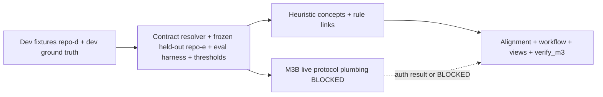

# Plan: M3 gated ontology (M3A / M3B / M3C)

## Goal

Revise M3 into three explicit gates — A deterministic evidence + reproducible eval harness, B separately-authorized live-model semantic experiment, C cross-repo alignment + workflow demo — so business knowledge (concepts with definitions/scope, rules with conditions/exceptions/outcomes, concept-rule-operation-state/event links, cross-repo process) is demonstrated with frozen dev + held-out ground truth, pre-declared thresholds with denominators and raw counts, and language honesty (Python-only bounded; Java/Spring/SQL explicitly deferred to a post-M3 gate). Implementation NOT approved — plan only.

## Architecture

Components touched: `bo_extract` (heuristic concepts; semantic_adapter gate only), new `bo_resolve.contract_resolver` (client/server call, event-schema, shared-table signals; compatibility≠equivalence), new `bo_eval.harness` (frozen-set loader, metric computation with raw counts), `bo_ontology.alignment` (typed mappings incl. `insufficient-evidence` + `distinctFrom`, workflow with unresolved segment), `bo_api` (reuse store/evidence/review/inspect; add read-only concept/alignment/workflow views), `bo_ontology.store/review/invalidation` (reused, not forked). Interfaces consumed: M2 deterministic extractor, SQLite manifest/provenance, `bo_review` CLI. Interfaces produced: frozen seals, eval report shape (heuristic vs model arms), alignment/workflow demo data.

## Tech Stack

Python ≥3.12 only; stdlib + existing repo deps; no new dependencies. Fixtures synthetic redistributable only. Test commands: `python3 -m pytest -q`, `python3 scripts/verify_m3.py`.

## Spec

Authoritative: `docs/architecture-m0.md`, `docs/milestone-plan-m0.md`, `docs/requirements-traceability.md`, `docs/verification-m2.md` (M2 baseline 98 tests), `tests/test_m2_ground_truth.py` (independent-label precedent: no `src` imports in ground-truth files). Gap requirements G1–G7 as briefed (gates, business-not-labels, dev/held-out eval, pre-declared thresholds, language honesty, UI limits, A/B/C structure). This plan only; no implementation authorized by this plan.

## Global Constraints

Python-only; no new languages in M3. No live calls in M3A/M3C (mocked protocol tests only). No silent provider fallback; no private-source egress; no NVIDIA integration. No edits to `tests/test_m2_ground_truth.py`, `scripts/verify_m1.py`, `scripts/verify_m2.py`. `docs/requirements-traceability.md` append-only. Review safeguard (`proposed` status) is never a metric numerator.

## Lean Constraints

Reuse-first: `bo_ontology.store/review/invalidation`, manifest/provenance, read-only inspect API/UI. New code minimal: one heuristic module, one contract resolver, one alignment module, one eval harness, one views module. No new parser/queue/DB; no abstraction beyond these five modules — any extra abstraction flagged for deletion.

## Review Focus

Freeze integrity (held-out never in prompts/extraction; seal-hash enforced); compatibility≠equivalence enforcement; `distinctFrom` vs false equivalence; abstention on plausible-but-unsupported probe; thresholds state denominators + raw counts; M3B auth gate airtight (no exec without record); contract-change invalidation preserves history; language-honesty statement present with post-M3 Java/Spring gate.

## Task table

Dependency order (multi-file interdependent): A1 → A2 (freeze) → B1-plumbing + C1 (parallel, both read-only on frozen seals) → C2 (needs M3A green + M3B result OR BLOCKED label). Post-freeze rule: A2 seals/tests immutable; C-tasks fix `src` only.

| # | Task | Spec req | Files | Test | Expected | Verify |
|---|------|----------|-------|------|----------|--------|
| A1 | Dev-fixture extension + frozen dev ground truth | G2 (§7/9), G3-dev, G5 | `fixtures/repo-d/app.py`, `fixtures/repo-d/rules.py`, `fixtures/repo-d/contracts.py`, `tests/test_m3_dev_ground_truth.py` | Dev ground truth asserts loyalty (non-refund) process + refund fixtures; no `src` imports | Second non-refund process + contract artifacts exist; dev labels frozen, independent of extractor | `python3 -m pytest tests/test_m3_dev_ground_truth.py -q` |
| A2 | Contract-resolution evidence + reproducible eval harness + frozen held-out + pre-declared thresholds | G1-gateA, G2-contracts, G3-heldout, G4-thresholds | `fixtures/repo-e/app.py`, `fixtures/repo-e/rules.py`, `fixtures/repo-e/contracts.py`, `docs/m3_heldout_seal.json`, `src/bo_resolve/__init__.py`, `src/bo_resolve/contract_resolver.py`, `src/bo_eval/__init__.py`, `src/bo_eval/harness.py`, `tests/test_m3_heldout_sealed.py`, `tests/test_m3_contract.py`, `tests/test_m3_eval.py`, `docs/verification-m3.md` | Held-out sealed (AST-only labels); contract tests assert 3 signals + compatibility≠equivalence; eval tests assert metric fn emits raw counts | Held-out frozen before final eval; harness computes metrics with x/y; thresholds with denominators recorded BEFORE runs | `python3 -m pytest tests/test_m3_contract.py tests/test_m3_eval.py tests/test_m3_heldout_sealed.py -q` |
| B1 | M3B live-experiment protocol plumbing only — execution BLOCKED pending second auth | G1-gateB, G3-compare | `src/bo_extract/semantic_adapter.py`, `prompts/m3b/extract_concepts.md`, `prompts/m3b/extract_rules.md`, `prompts/m3b/align_workflow.md`, `prompts/m3b/AUTH_REQUIRED.md`, `tests/test_m3b_protocol.py` | Mocked adapter test: unauthorized → no network, returns BLOCKED; prompt files contain no creds/endpoints | Adapter wiring + stored prompts + cost-cap + artifact-ledger shape exist; live execution impossible without auth record | `python3 -m pytest tests/test_m3b_protocol.py -q` |
| C1 | Heuristic concept discovery + rule-concept-operation-state links (proposed-status) | G1-gateC-part, G2-concepts/rules, G6-reuse | `src/bo_extract/heuristic_concepts.py` | Dev ground truth + alignment-shape tests on dev split only (held-out never loaded) | Candidate concepts with definitions + scope; rules with conditions/exceptions/outcomes; links to operations/states; all `proposed`, unreviewed | `python3 -m pytest tests/test_m3_dev_ground_truth.py tests/test_m3_alignment.py -q -k dev` |
| C2 | Alignment + workflow demo + minimal views + full verification + contract-change invalidation | G2-mappings/workflow, G5-honesty, G6-UI/invalidation, G7-structure | `src/bo_ontology/alignment.py`, `src/bo_api/views_m3.py`, `src/bo_api/server.py`, `tests/test_m3_alignment.py`, `tests/test_m3_heldout_sealed.py`, `scripts/verify_m3.py`, `docs/m3-capability.md`, `docs/verification-m3.md`, `docs/requirements-traceability.md` | Full held-out eval via harness; workflow contains one unresolved segment; rule/contract change marks dependents `stale` with history intact | Typed mappings incl. `insufficient-evidence` + `distinctFrom`; cross-repo process demo; heuristic-vs-model report (BLOCKED arm if unauthorized); capability states Python-only + post-M3 Java/Spring gate | `python3 scripts/verify_m3.py` |

## Per-task notes

- **A1:** `repo-d` = dev-only loyalty-points process (earn/redeem/expiry, manager-adjust exception), structurally unlike refund. `contracts.py` carries synthetic client/server function pairs + event-schema dict + shared-table name constants. `tests/test_m3_dev_ground_truth.py` follows `test_m2_ground_truth.py` precedent: `ast`-only, zero `src` imports, label constants asserted directly.
- **A2 thresholds (recorded in `docs/verification-m3.md` BEFORE any final eval; all with denominators + raw x/y):** concept correctness ≥75% (x/N-concepts per split); rule correctness ≥75% (x/N-rules); relation correctness ≥70% (x/N-relations) AND 0 false equivalences on same-name/different-meaning pairs (0/N-confusables, `distinctFrom` asserted); citation 100% format-valid (x/N-citations) reported separately from ≥90% supported (x/N-citations with file+line+hash match); abstention 100% on plausible-but-unsupported probe (1/1 → `proposed` + `insufficient-evidence`, never `accepted`). `proposed` excluded from numerators. Held-out must contain: differently-shaped exchange impl, ≥1 small non-refund (store-credit), same-name/different-meaning pair, different-name/related-meaning pair, one plausible-but-unsupported relation that must be rejected. Seal (`docs/m3_heldout_seal.json`): file hashes + timestamp + label-commit; `harness.py` refuses to run if seal mismatch; any held-out use for tuning re-labels it dev and requires a fresh holdout before generalization claims. `contract_resolver.py` signature: `resolve(repo_paths) -> {call_edges, event_schema_links, shared_table_links, compatibility_flags}` where every flag defaults to `compatible-not-equivalent`; equivalence requires human-accepted mapping, never inferred from call/contract match.
- **B1:** `AUTH_REQUIRED.md` is the auth-record template: provider/model + endpoint, exact egress data, max calls/tokens/spend, stopping conditions, artifact destinations (stored prompts/outputs/evidence/eval). `semantic_adapter.py` edit only: explicit `mode ∈ {mock, authorized-live}`; unauthorized path raises `BlockedError`, no fallback, no network import. Local-model use also requires approval (resource limits; no install/invoke without record). Plumbing tests mocked only.
- **C1:** `heuristic_concepts.py`: `discover(repo_paths) -> {concepts[{name, definition, scope}], rules[{conditions, exceptions, outcomes}], links[{rule, concept, operation, state/event}]}`; all outputs `origin=model-inferred|deterministic`, `status=proposed`. Never loads `fixtures/repo-e` or seal contents.
- **C2:** `alignment.py`: `align(local_a, local_b) -> typed mappings {equivalentTo, overlapsWith, distinctFrom, insufficient-evidence}` preserving local meanings; `build_workflow(...)` must emit ≥1 `unresolved` segment. Invalidation test (`tests/test_m3_contract.py` + `test_m3_alignment.py`): mutating a contract/supporting rule marks dependent cross-repo assertions `stale` (via reused `invalidation.py`), original rows preserved. `views_m3.py`: read-only concept/alignment/workflow JSON views reusing store/review; `server.py` change is mount-only. `scripts/verify_m3.py` runs: M2 regression (98-test baseline intact), M3A gates, M3B protocol (expects BLOCKED without auth record), M3C demo, seal check, threshold report with raw counts, heuristic-vs-model table (mock arm labeled non-evaluative; null results pass). `docs/m3-capability.md` must state: Python-only bounded experiment does NOT satisfy Java/Spring/SQL; post-M3 gate (representative Java/Spring workflow validation) required before broader UI/scale. Approval boundaries: M3A runnable on plan approval; M3B execution needs second explicit auth record; C2 demo needs M3A green + (M3B result OR BLOCKED label).

## Requirement coverage

- [ ] G1 gates A/B/C → A2, B1, C1/C2; mocks never satisfy B/C quality; M3B auth fields + BLOCKED fallback in B1/C2
- [ ] G2 business-not-labels → A1, A2 (contracts), C1 (definitions/scope/conditions/exceptions/links), C2 (process, insufficient-evidence, compatibility≠equivalence)
- [ ] G3 dev + frozen held-out with all five probe types + misuse rule + heuristic-vs-model same-ground-truth report → A1, A2, B1, C2
- [ ] G4 thresholds + denominators + raw counts BEFORE runs; proposed≠metric → A2, C2
- [ ] G5 Python-only honesty + post-M3 Java/Spring gate; no new languages → A1/A2 fixtures, C2 capability doc
- [ ] G6 reuse UI + minimal views + stale-without-history-loss test → C2
- [ ] G7 A/B/C structure + exact files + deps-none-new + approval boundaries + no fallback/egress/NVIDIA + plan-only → all tasks
- [ ] Every task names a spec req; no orphan task; no task edits `test_m2_ground_truth.py` / `verify_m1.py` / `verify_m2.py`; post-freeze seals/tests immutable (C-tasks fix `src` only)

## Test integrity

New `tests/test_m3_*.py` are deliverables verified by `scripts/verify_m3.py`; sealed files (`tests/test_m3_heldout_sealed.py`, `docs/m3_heldout_seal.json`) frozen in A2. If a grader is wrong, stop and escalate — do not weaken tests to pass.

## Self-review

Authoritative draft restored 2026-11-17 from session history (planner output ses_e1564df88ffe). Defective persist version preserved at docs/plans/m3-gated-ontology.defective-2026-11-17.md. Reversed C-requirement corrected: G2 requires business knowledge (definitions/scope/conditions/exceptions/links/process), NOT neutral-terms relabeling. Frontmatter files list = 29 implementation paths + allow 2 ledger files (verbatim). Status draft, approved_by/at empty — implementation NOT approved by this repair.